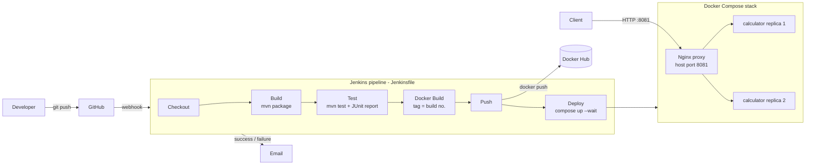

# Calculator REST API — End-to-End CI/CD Pipeline

CSE 816 Software Production Engineering — Mini-Project.

A small Spring Boot calculator API wrapped in a fully automated DevOps pipeline:
**GitHub → Jenkins → Maven build & JUnit tests → Docker image → Docker Hub → Docker Compose deployment (Nginx + 2 replicas)**, with email notifications.

- GitHub repository: https://github.com/ShivekRanjan/calculator-devops
- Docker Hub image: https://hub.docker.com/r/shivek414/calculator
- Setup guide (Jenkins, Docker Hub, email, webhook): [docs/SETUP.md](docs/SETUP.md)

## Architecture



## API

| Operation | Endpoint | Behaviour |
|---|---|---|
| Add | `GET /api/v1/add?a=&b=` | `a + b` |
| Subtract | `GET /api/v1/subtract?a=&b=` | `a - b` |
| Multiply | `GET /api/v1/multiply?a=&b=` | `a * b` |
| Divide | `GET /api/v1/divide?a=&b=` | `a / b`; `b = 0` → HTTP 400 |
| Health | `GET /actuator/health` | `{"status":"UP"}` |
| Info | `GET /actuator/info` | app version and the Jenkins build number running |

Arithmetic is done with `BigDecimal` (34 significant digits), so `0.1 + 0.2` returns `0.3`, not `0.30000000000000004`.

**Success**

```bash
curl "http://localhost:8080/api/v1/add?a=2&b=3"
# {"operation":"add","a":2,"b":3,"result":5}
```

**Errors** — always HTTP 400 with the same JSON shape:

```bash
curl "http://localhost:8080/api/v1/divide?a=5&b=0"
# {"timestamp":"2026-10-26T09:15:02.113Z","status":400,"error":"Bad Request",
#  "message":"Division by zero is not allowed","path":"/api/v1/divide"}
```

| Request | `message` |
|---|---|
| `?a=5&b=0` on `/divide` | `Division by zero is not allowed` |
| `?a=1` (b missing) | `Missing required parameter 'b'` |
| `?a=&b=1` | `Parameter 'a' must not be empty` |
| `?a=abc&b=1` | `Parameter 'a' must be a number, but was 'abc'` |
| `?a=NaN&b=1` | `Parameter 'a' must be a finite number` |

> Windows PowerShell: use `curl.exe` (plain `curl` is an alias for `Invoke-WebRequest`).

## Build, test and run locally

Requires JDK 21 and Maven 3.9+.

```bash
mvn clean package -DskipTests   # build target/calculator.jar
mvn test                        # unit + integration tests
                                #   JUnit XML  -> target/surefire-reports/
                                #   coverage   -> target/site/jacoco/index.html
java -jar target/calculator.jar # API on http://localhost:8080
```

Tests:

- `CalculatorServiceTest` — JUnit 5 unit tests for every operation, divide-by-zero, NaN/Infinity.
- `CalculatorApiIntegrationTest` — `@SpringBootTest` + MockMvc calling the real endpoints, error responses and `/actuator/health`.

## Docker

Multi-stage `Dockerfile`: a Maven + JDK 21 stage builds the JAR, and a slim `eclipse-temurin:21-jre-alpine` stage runs it as a non-root user. Dependencies are cached in their own layer, so code-only changes rebuild quickly.

```bash
docker build -t calculator-api .
docker run --rm -p 8082:8080 calculator-api
curl "http://localhost:8082/api/v1/multiply?a=6&b=7"
```

## Docker Compose (full stack)

`docker-compose.yml` starts **two calculator replicas** on a private network behind an **Nginx reverse proxy**. It includes health checks on `/actuator/health`, restart policies, environment variables, and memory limits.

```bash
docker compose up -d                 # builds images if needed, starts the stack
docker compose ps                    # all containers should be "healthy"
curl -i "http://localhost:8081/api/v1/add?a=2&b=3"
docker compose down
```

The `X-Served-By` response header shows which replica answered. Call the API a few times and it alternates.

| Variable | Default | Purpose |
|---|---|---|
| `DOCKER_IMAGE` | `calculator-api` | Image name (Jenkins sets `<user>/calculator`) |
| `IMAGE_TAG` | `latest` | Image tag (Jenkins sets the build number) |
| `PROXY_PORT` | `8081` | Host port for Nginx (8080 is usually taken by Jenkins) |

## CI/CD pipeline (Jenkinsfile)

| Stage | What it does |
|---|---|
| Checkout | `checkout scm` — latest commit from GitHub (triggered by webhook, Poll SCM as fallback) |
| Build | `mvn clean package -DskipTests` |
| Test | `mvn test`; publishes JUnit results and archives the JaCoCo report; a failing test fails the build |
| Docker Build | `docker build` tagged `<user>/calculator:<BUILD_NUMBER>` and `:latest` |
| Push | `docker login` with the Jenkins credential `dockerhub-credentials`, then `docker push` both tags |
| Deploy | `docker compose up -d --wait` (blocks until healthy) + smoke test through Nginx |
| Post | HTML email on success / failure (build log attached on failure) |

The pipeline is idempotent. Compose only recreates containers whose image changed, and re-running the same build leaves the running stack untouched. Nginx re-resolves the replicas every 5 s, so it keeps working after a redeploy without a restart. The same Jenkinsfile runs on Linux (`sh`) and Windows (`bat`) agents.

## Project structure

```
calculator-devops/
├── src/main/java/com/spe/calculator/
│   ├── CalculatorApplication.java
│   ├── controller/CalculatorController.java    # REST endpoints
│   ├── service/CalculatorService.java          # arithmetic + validation
│   ├── model/CalculationResponse.java          # success JSON
│   ├── model/ErrorResponse.java                # error JSON
│   └── exception/                              # 400 error handling
├── src/main/resources/application*.properties
├── src/test/java/com/spe/calculator/           # JUnit 5 + MockMvc tests
├── nginx/Dockerfile, nginx/nginx.conf          # reverse proxy
├── Dockerfile                                  # multi-stage build
├── .dockerignore
├── docker-compose.yml                          # proxy + 2 replicas
├── Jenkinsfile                                 # declarative CI/CD pipeline
├── docs/SETUP.md                               # Jenkins / Docker Hub / email / webhook setup
├── .gitignore
└── README.md
```
